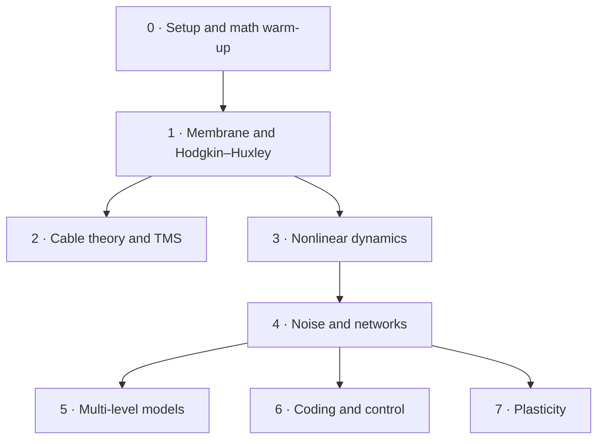

# compneuro-study

[](https://github.com/610607/compneuro-study/actions/workflows/tests.yml)

A math-first path through computational neuroscience, studied for interest. Every model is derived by hand, written up as a note, then implemented from scratch and checked against an analytic limit.

Nothing here is a schedule. Phases can be skipped, reordered or lingered over; the only real dependencies are the arrows below.



| Phase | Topic | Notes | Code |
| --- | --- | --- | --- |
| [0](phases/p0-setup-math/README.md) | Setup, ODE solvers, stochastic processes | [Ornstein–Uhlenbeck](notes/ornstein-uhlenbeck.md) | `compneuro.integrators` |
| [1](phases/p1-membrane-hh/README.md) | Membrane biophysics, Hodgkin–Huxley | [Nernst–Planck](notes/nernst-planck.md), [Nernst](notes/nernst.md), [GHK](notes/ghk.md), [HH](notes/hodgkin-huxley.md), [gating](notes/gating-kinetics.md) | `compneuro.membrane` |
| [2](phases/p2-cable-tms/README.md) | Cable theory, extracellular and TMS stimulation | [cable](notes/cable-equation.md), [activating function](notes/activating-function.md) | `compneuro.cable` |
| [3](phases/p3-nonlinear-dynamics/README.md) | Phase planes, bifurcations, phase response | [FHN](notes/fitzhugh-nagumo.md), [theta neuron](notes/theta-neuron.md), [phase reduction](notes/phase-reduction.md) | `compneuro.dynamics` |
| [4](phases/p4-noise-networks/README.md) | Stochastic neurons, spiking networks | [LIF](notes/lif.md), [Fokker–Planck](notes/fokker-planck-lif.md) | `compneuro.spiking` |
| [5](phases/p5-multilevel-models/README.md) | Neural mass, neural fields, whole brain, BOLD | [Wilson–Cowan](notes/wilson-cowan.md), [MPR](notes/mpr-mean-field.md), [Amari](notes/amari-neural-field.md), [whole brain](notes/whole-brain-network.md), [Balloon–Windkessel](notes/balloon-windkessel.md) | `compneuro.populations` |
| [6](phases/p6-coding-control/README.md) | Encoding, decoding, state-space control, DCM | [Poisson GLM](notes/poisson-glm.md), [fMRI GLM](notes/fmri-glm.md), [Fisher information](notes/fisher-information.md), [state space + LQR](notes/state-space-lqr.md), [DCM](notes/dcm.md) | `compneuro.coding` |
| [7](phases/p7-plasticity/README.md) | Hebbian learning, STDP | [Oja](notes/oja.md), [STDP](notes/stdp.md) | `compneuro.plasticity` |

Projects that touch unpublished research or private data (mini-project A1, Capstones A and B, analysis of my own fMRI data) live in a separate private repo that installs this one as a package.

## Layout

```text
notes/            one Markdown note per equation (template: notes/_template.md)
phases/           one folder per phase: README with goals, readings, self-test, log
src/compneuro/    from-scratch implementations, one module per phase (stubs to fill in)
tests/            analytic-limit checks; each skips until its function is implemented
reading/          refs.bib + reading.md
review/           cards.md: spaced-review cards
```

## Running

```bash
conda env create -f environment.yml   # or: pip install -e ".[dev]"
conda activate compneuro
pytest -rs                            # -rs lists which checks are still waiting on a stub
```

Every function in `src/compneuro/` starts as a stub that raises `NotImplementedError`. Its test skips until the stub is filled in, then checks it against an analytic limit. CI runs the same tests on every push, so a green badge means "nothing implemented is wrong", not "everything is done".

`tests/test_p0_example.py` is a worked example of the pattern: a model, its analytic solution, and a convergence-order check.

## Working with Claude

[`CLAUDE.md`](CLAUDE.md) sets the rules for any Claude session on this repo: hints rather than solutions, no filling in stubs unless asked, nothing private in this public repo. In a cloud session (claude.ai/code, the Claude app's Code tab, or `claude --cloud`), a startup hook installs the package automatically, and these commands are available:

| Command | What it does |
| --- | --- |
| `/derive <note>` | Work through a derivation step by step, with hints; records your steps in the note |
| `/check <phase>` | Run that phase's checks and explain failures with hints, not fixes |
| `/quiz [n]` | Spaced-review quiz from `review/cards.md`, logged to `review/history.md` |
| `/tutor-review <PR>` | Review a pull request against its note and tests; posts hints as a PR comment |
| `/weekly-review` | Open a GitHub issue with this week's review cards (meant for a scheduled routine) |

## Licence

Code: [MIT](LICENSE). Notes and other prose: [CC BY 4.0](LICENSE-notes.md).
